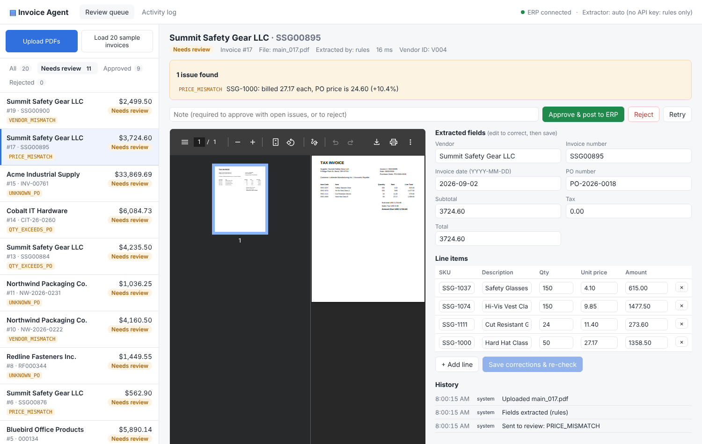
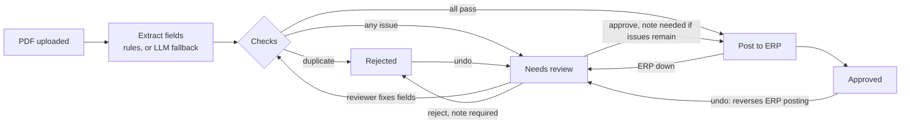
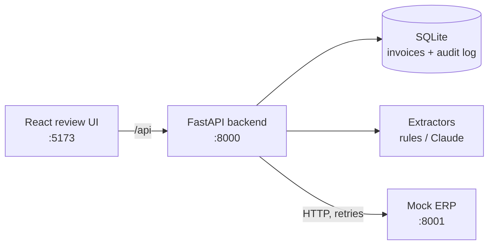

# Invoice Agent

An accounts-payable workflow that reads supplier invoices, checks them against purchase orders in the accounting system, auto-approves the safe ones, and sends everything else to a human with a clear reason.

The focus is **workflow reliability**: every invoice ends in a known state, every decision is logged and can be undone, and an evaluation measures how often it gets things right.

### Demo (2 min)

<!-- On github.com: edit this file, click on the empty line below this comment, and drag in docs/invoice-agent-demo-bw.mp4. GitHub turns it into a playable video. -->
<p align="center">
  
</p>


https://github.com/user-attachments/assets/00da5c00-6402-4e1d-bc38-b8dc75386f71

---

## The problem

*Scenario (fictional client):* Lakeside Manufacturing's AP team keys in every supplier invoice by hand, checks it against the purchase order, and chases mismatches over email. Errors cause overpayments and duplicate payments, and nobody can say why a given invoice was paid.

**What "better" means for them:**
1. Clean invoices get paid without anyone touching them
2. Problem invoices reach a person with the reason already identified
3. Nothing gets paid twice, and nothing gets approved that shouldn't be
4. Every decision can be explained and reversed

## What it does



**Checks, in order.** The first two run without the ERP, so they still work during an outage.

| # | Check | Issue code |
|---|---|---|
| 1 | Document has readable text and the required fields | `UNREADABLE`, `MISSING_FIELDS` |
| 2 | Same vendor and invoice number not already received | `DUPLICATE` (auto-rejected) |
| 3 | Lines, subtotal, tax and total add up | `TOTALS_MISMATCH` |
| 4 | Vendor exists in the vendor master | `UNKNOWN_VENDOR` |
| 5 | PO present, exists, and belongs to this vendor | `MISSING_PO`, `UNKNOWN_PO`, `VENDOR_MISMATCH` |
| 6 | Each line is on the PO, within remaining quantity, at the PO price (±0.5%) | `ITEM_NOT_ON_PO`, `QTY_EXCEEDS_PO`, `PRICE_MISMATCH` |
| – | ERP unreachable after 3 retries | `ERP_UNAVAILABLE` (goes to review, never approved) |

Design rule: **the LLM only reads the document. Every decision is made by deterministic code**, so a model mistake can send an invoice to review, but it can't approve one on its own.

## Architecture



The mock ERP stands in for the client's real accounting system (NetSuite, SAP, QuickBooks). The backend talks to it only over HTTP, the same way it would talk to a real one.

## Results

Measured with `python -m eval.run_eval`. Every run uses a fresh database and a freshly seeded ERP. Full reports are in [`backend/eval/results/`](backend/eval/results/).

| Test | Correct outcome | False approvals | Clean invoices auto-approved |
|---|---|---|---|
| Main set: 100 invoices, 3 layouts, 10 scenario types | 100% (100/100) | 0 of 54 | 100% (46/46) |
| Main set with 30% of ERP calls failing | 94% (94/100) | 0 of 54 | 89% (41/46) |
| Holdout: 20 invoices in a layout the rules never saw | 10% (2/20) | 0 of 8 | 0% (0/12) |

**How to read this honestly:**
- **The main set is synthetic, and the rules extractor was written for its 3 layouts.** A perfect score there shows the *check logic* is correct. It does not show the extractor generalizes.
- **The holdout set is the real test of extraction, and the rules extractor fails it**: 0% field accuracy on an unfamiliar layout. It still **fails safe**: every invoice went to review and none were wrongly approved. That gap is the reason for the LLM fallback (`EXTRACTOR=auto`). Its accuracy on the holdout set and the scans is **not yet measured**. Run `python -m eval.run_eval --set holdout --extractor auto` with an API key to measure it.
- **With a flaky ERP**, the 6 misses are invoices that correctly went to review as `ERP_UNAVAILABLE` instead of being approved. The flaky-ERP test exposed a real bug: duplicate detection depended on the ERP, so a resubmitted invoice slipped through. It's fixed (local checks now run first), and this test guards against it coming back.
- **Not measured yet:** time saved against a manual baseline. That needs someone to time manual processing of the same invoices.

## Run it locally

**You need:** Python 3.10+ and Node.js 18+. Check with `python3 --version` and `node --version`.

### 1. Install (once)

macOS / Linux:
```bash
cd backend
python3 -m venv .venv
source .venv/bin/activate
pip install -r requirements.txt
cd ../frontend
npm install
```

Windows (PowerShell):
```powershell
cd backend
python -m venv .venv
.venv\Scripts\Activate.ps1
pip install -r requirements.txt
cd ..\frontend
npm install
```

The sample invoices are already included. To regenerate them: `cd backend && python -m scripts.generate_dataset`.

### 2. Start the three services (three terminal windows)

Activate the virtual environment in each backend terminal first (`source .venv/bin/activate`, or `.venv\Scripts\Activate.ps1` on Windows).

| Terminal | Folder | Command | Check it works |
|---|---|---|---|
| 1. Mock ERP | `backend/` | `uvicorn mock_erp.main:app --port 8001 --reload` | http://localhost:8001/docs |
| 2. Backend API | `backend/` | `uvicorn app.main:app --port 8000 --reload` | http://localhost:8000/docs |
| 3. Review UI | `frontend/` | `npm run dev` | http://localhost:5173 |

On macOS/Linux, `make setup`, then `make erp`, `make api` and `make ui` do the same.

### 3. Try it

1. Open http://localhost:5173 and click **Load 20 sample invoices**.
2. Open **Needs review** and pick a `PRICE_MISMATCH` invoice. Try **Approve** without a note (it's blocked), then add a note and approve.
3. Pick a `MISSING_PO` invoice and type the PO number into the field. Click **Save corrections & re-check** to watch the checks re-run.
4. Open an approved invoice and click **Undo**. The ERP posting is reversed.
5. Open **Activity log** to see every decision.
6. Upload your own PDF with **Upload PDFs**.

### 4. Tests and evaluation

```bash
cd backend
pytest -q                                      # 12 tests
python -m eval.run_eval                        # main set
python -m eval.run_eval --set holdout          # unseen layout
python -m eval.run_eval --erp-fail-rate 0.3    # flaky ERP
```

### 5. Optional: turn on the LLM extractor

```bash
cp .env.example .env   # in backend/
# set ANTHROPIC_API_KEY=... and keep EXTRACTOR=auto
```

Restart the API. Scans and unfamiliar layouts now go to Claude; everything else still uses the free rules extractor.

**Testing an ERP outage:** stop terminal 1 and upload an invoice. It lands in review as `ERP_UNAVAILABLE`. Start the ERP again and click **Retry**.

## Project structure

```
backend/
  app/
    main.py            HTTP API (FastAPI)
    pipeline.py        the workflow: process, approve, reject, undo, edit, retry
    matching.py        the business checks
    erp_client.py      ERP calls with timeouts and retries
    extraction/        rules.py (patterns), llm.py (Claude), normalize.py (cleaning values)
    db.py, schemas.py  tables and data shapes
    config.py          settings from environment / .env
  mock_erp/main.py     stand-in accounting system
  scripts/generate_dataset.py   creates the invoices, labels and ERP data
  eval/run_eval.py     the evaluation
  tests/               API-level tests
  data/                invoices, labels, ERP seed (generated)
frontend/src/          React review UI
docs/HOW_IT_WORKS.md   a guided tour of the code
```

## Limitations

- Synthetic data only. Real supplier invoices are messier: multi-page, credit notes, multiple currencies, handwritten notes.
- The rules extractor only knows 3 layouts. The LLM fallback is wired in, but its accuracy hasn't been measured yet.
- Two-way match only (invoice vs PO). There's no goods-receipt check (three-way match).
- Single user, no login or roles; anyone with the URL can approve.
- Uploads are processed synchronously. Large batches would need a job queue.
- Retrying a failed ERP *post* is safe here because the mock ERP rejects duplicates (409). A real integration needs explicit idempotency keys.

## What I'd do next

1. Measure the LLM fallback on the holdout set and the scans, and compare cost per invoice with the rules extractor.
2. Time manual processing of 20 invoices to get a real time-saved number.
3. Add the goods-receipt check (three-way match).
4. Add reviewer login and approval limits by amount.
5. Run in Docker, deploy to AWS, and replace SQLite with Postgres.
